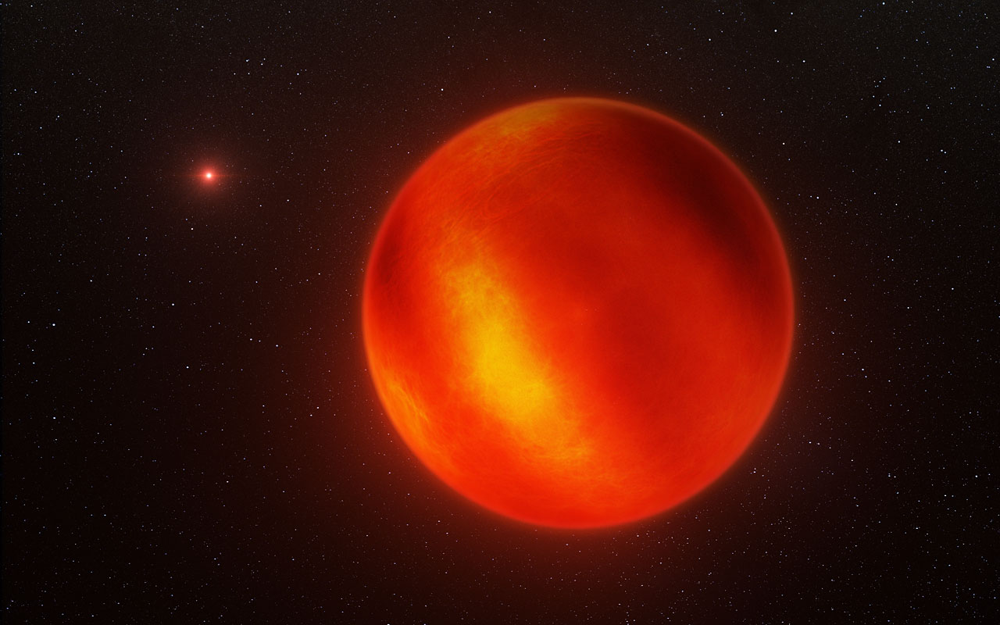
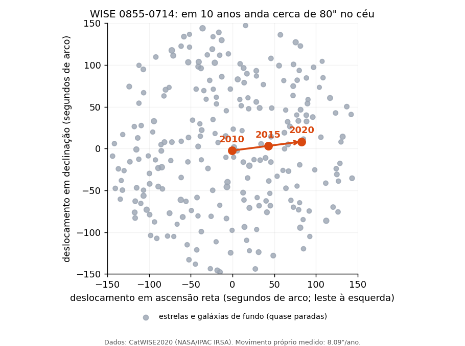
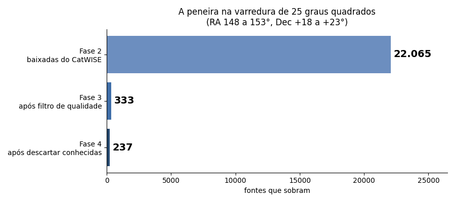
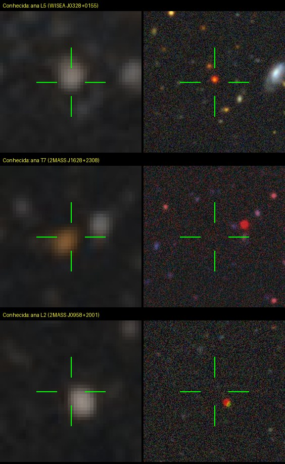
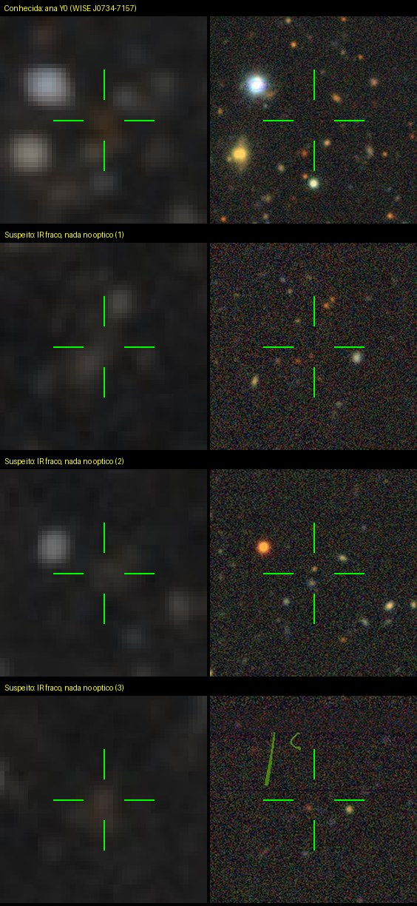
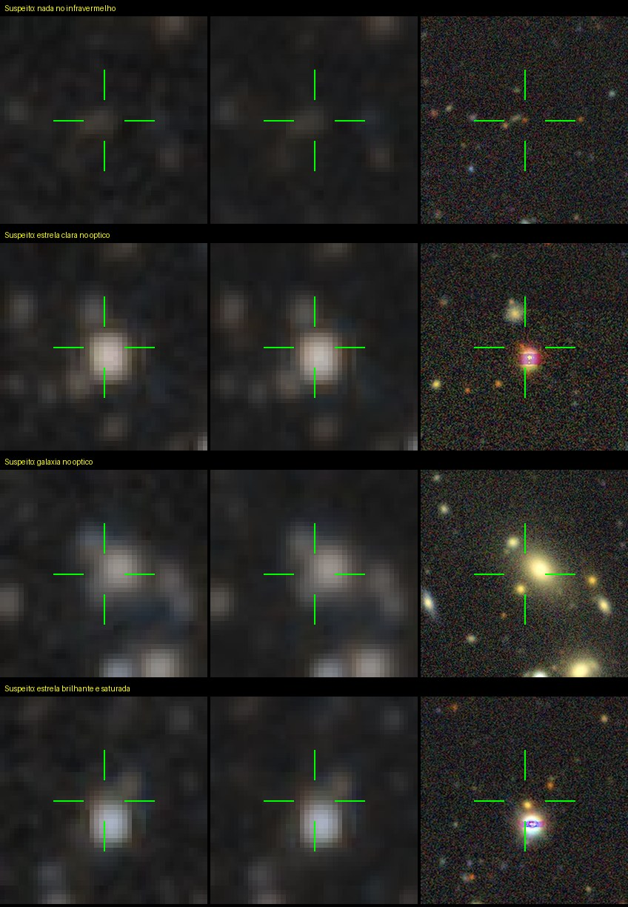
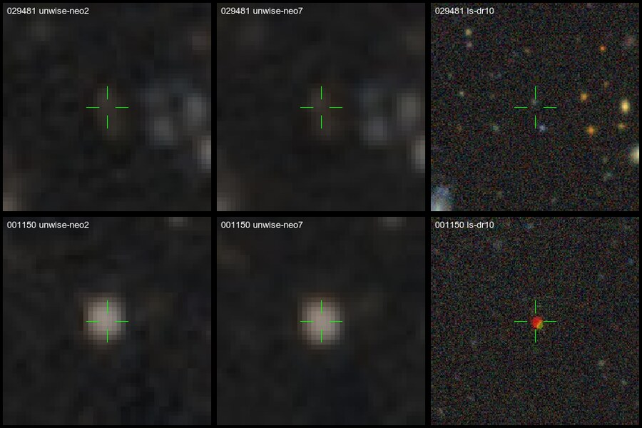

# Rastro

[](https://github.com/mpena2099/rastro/actions/workflows/testes.yml)

Pipeline pessoal de mineração de dados astronômicos que caça **anãs marrons e estrelas frias próximas ao Sol** ainda não catalogadas, procurando por **movimento próprio anômalo** no catálogo público **CatWISE2020**.



*Ilustração artística de uma anã marrom (Luhman 16B), parte do terceiro sistema mais próximo do Sol. Crédito: ESO/I. Crossfield/N. Risinger (skysurvey.org), [CC BY 4.0](https://creativecommons.org/licenses/by/4.0/).*

## English summary

Rastro is a personal data-mining pipeline that hunts for **uncatalogued brown dwarfs and cool stars near the Sun** through **high proper motion** in the public **CatWISE2020** catalogue (queried via IRSA TAP). Five automated phases share state through SQLite: a sanity check that recovers Luhman 16 and compares its measured proper motion, a tiled field download with server-side cuts, quality filtering (proper-motion significance, W2 SNR, contamination flags, pmcode), removal of known objects by cross-match with SIMBAD and 11 VizieR lists of ultracool dwarfs, and an LLM triage that only ranks, never decides. Two manual phases follow: a local Streamlit app for visual review (unWISE and Legacy Surveys cutouts, Gaia/Pan-STARRS counterparts, and a consistency test of the motion against AllWISE positions) and an HTML report for a second opinion. Recall against 949 known L/T/Y dwarfs from SIMBAD is about 76%. A 25 deg² scan (RA 148-153, Dec +18 to +23) left 237 candidates under review. The best one turned out to be already published as a photometric L5 candidate (Karpov et al. 2025), found independently; no discovery is claimed. Code and docs are in Portuguese; `config.py` holds every parameter. Run with `python pipeline.py`; offline tests with `python tests/test_units.py`.

## Em palavras simples

**A pergunta:** existem objetos frios e escuros perto do Sol que ninguém descobriu ainda?

**O que se procura:** as *anãs marrons*, "estrelas fracassadas". Têm massa demais pra serem planetas e de menos pra acender como uma estrela. Quase não emitem luz visível, mas emitem calor (infravermelho), então um telescópio infravermelho consegue enxergá-las.

**Como achar:** as estrelas parecem paradas no céu, mas as que estão perto se mexem devagar, ano após ano. É como olhar a paisagem pela janela do carro: o poste ao lado passa rápido, a montanha ao longe parece parada. Esse deslocamento no céu se chama *movimento próprio*. Um objeto que se move muito pra um ponto tão apagado é um forte suspeito de estar perto de nós.



*Quase tudo no fundo (cinza) fica no lugar. A WISE 0855-0714 (laranja), a anã marrom mais fria que se conhece, anda cerca de 80 segundos de arco em 10 anos. É esse tipo de movimento que o projeto procura.*

**Onde estão os dados:** o telescópio espacial WISE fotografou o céu todo várias vezes ao longo de 8 anos. Astrônomos já transformaram essas fotos numa enorme tabela pública, o *CatWISE2020*, com 1,89 bilhão de linhas. Cada linha é um ponto de luz, com sua posição, seu brilho e o quanto ele se mexeu. **O projeto não olha fotos nem usa telescópio: ele lê essa tabela e filtra.**

**O que o programa faz, passo a passo.** Pense numa peneira com várias malhas, cada uma deixando passar menos gente:

1. **Confere as ferramentas.** Procura dois objetos famosos que já se conhece. Se não os achar, algo está errado e o programa para.
2. **Baixa um pedaço do céu.** Hoje, 25 graus quadrados (quadrados de 1 grau por 1 grau, cada um com cerca de 5 vezes a área da Lua cheia), só com pontos que se movem rápido.
3. **Joga fora medidas duvidosas.** Defeitos do instrumento, pontos colados em vizinhos e movimentos pequenos demais pra distinguir de erro de medida.
4. **Joga fora o que já é conhecido.** Compara com o SIMBAD, o grande cadastro de objetos astronômicos, e com listas publicadas de anãs frias que o SIMBAD ainda não absorveu.
5. **Pede a nota de uma IA.** Uma IA lê os números de cada sobrevivente e dá uma nota de prioridade. Ela só ajuda a ordenar, nunca decide.
6. **Olhar humano.** As imagens de cada suspeito são conferidas à mão, num app local (`streamlit run app/revisao.py`) que mostra os recortes, os números e a nota da IA, e guarda a sua decisão.
7. **Relatório pra um astrônomo.** Os candidatos que você confirmou saem numa página só, com imagens e números, prontos pra pedir uma segunda opinião. A opinião em si ainda está por fazer.



**O que esperar:** quase tudo que passa pela peneira é falso alarme ou já era conhecido, e isso é normal até em projetos profissionais. No campo de teste, o programa reencontrou sozinho uma anã marrom que já estava catalogada, sinal de que os filtros funcionam. Na varredura de 25 graus quadrados sobraram 237 candidatos, e ainda não há lista curta e defensável: falta a confirmação visual. O melhor suspeito confirmado a olho já tinha sido publicado em 2025 como candidata a anã L5 (Karpov et al.), achado de forma independente: os filtros apontam pro lugar certo, mas a concorrência é real. Uma descoberta nova é o horizonte, não a promessa.

## O que entra, o que sai e o que fazer com isso

**O que alimenta o programa**
- **Uma região do céu**, dada por coordenadas (RA e Dec) em `config.py`, e os limiares dos filtros (quão rápido o ponto tem de se mover, quão nítida a medida precisa ser).
- **Dois bancos de dados públicos**, baixados da internet na hora: a tabela CatWISE2020 (NASA/IPAC) e o cadastro SIMBAD (CDS, Estrasburgo).
- **Uma chave grátis de IA** (Groq), só pra nota da última fase.

**O que ele devolve**

Uma tabela, `candidatos_fase5`, no arquivo `data/rastro.db`. Cada linha é um **suspeito**: código da fonte, posição no céu, brilho e cor no infravermelho, movimento próprio (e quantas vezes ele é maior que o erro de medida), a nota da IA (`alta`, `media`, `baixa` ou `incerta`) e um parágrafo curto com o motivo da nota. Pra ver a lista, ordenada pelos que mais se movem:

```bash
python -c "import sqlite3, pandas as pd; print(pd.read_sql('SELECT source_id, ra, dec, pm_total, llm_triage_score FROM candidatos_fase5 ORDER BY pm_total DESC', sqlite3.connect('data/rastro.db')))"
```

**O que fazer com o resultado**

A lista é de *suspeitos*, não de descobertas. O caminho depois dela:
1. **Olhar as imagens** dos suspeitos, começando pelos que o AllWISE mostra se movendo (a nota da IA é só um comentário). O app `app/revisao.py` (veja [Como usar](#como-usar)) mostra os recortes de cada suspeito e grava sua decisão. Os recortes mostram se há um objeto real ali, mas não o movimento: a imagem do infravermelho empilha 10 anos de fotos. O movimento se vê no [WiseView](http://byw.tools/wiseview), que anima as épocas, e no teste do AllWISE.
2. **Descartar os falsos alarmes.** Na prática, quase todos caem aqui: ruído, defeito do instrumento ou ponto mal medido.
3. **Levar os que sobrarem a um astrônomo**, que pode confirmar com outras observações (um espectro, por exemplo) e, se for novo de verdade, publicar.

**Como decidir na revisão visual**

| O que você vê | Decisão |
|---|---|
| Nada no centro das imagens de infravermelho, só ruído | **Descartar** |
| Mancha larga e difusa (galáxia), ou colada numa estrela brilhante, ou no meio dos "raios" de uma estrela | **Descartar** |
| No óptico, uma estrela clara (branca, amarela ou azul) no centro | **Descartar** (estrela comum) |
| Ponto nítido no infravermelho, laranja ou avermelhado, e **nada** no óptico | **Confirmar** (compatível com anã T ou Y) |
| Ponto nítido no infravermelho e um ponto **vermelho fraco** no óptico | **Confirmar** (compatível com anã L), mas com cor W1-W2 abaixo de ~0,3 pode ser só uma anã M comum, então prefira **Dúvida** |
| Ponto no infravermelho, mas fraco, colado numa vizinha, ou você não conseguiu conferir o movimento | **Dúvida** |

**Detalhes que ajudam**
- O objeto se move. No óptico, ele pode estar um pouco deslocado da mira, na direção do movimento (movimento próprio x anos de diferença entre as imagens). Dentro do espaço vazio da mira (cerca de 6") ainda conta como no lugar.
- No unWISE, cor avermelhada ou alaranjada é o que se espera de uma anã fria. Azul ou branco é estrela comum.
- O app compara cada candidato com o AllWISE (~2010): "se moveu (confere)" reforça o caso, "não se moveu" pesa contra, e "sem fonte" não diz nada (o candidato é fraco demais pra aparecer lá).
- **Confirmar** não é descoberta: quer dizer "passa no olho". O teste decisivo é abrir o link do WiseView e ver o ponto andando sempre na mesma direção ao longo dos anos. Quem não anda é ruído.
- **Descartar** não apaga nada: a decisão fica gravada com a nota e dá pra rever no filtro "Situação".

**Casos de referência**

*Confirmar*



Em cada linha: infravermelho (unWISE NEO7) e óptico (Legacy Surveys). As três primeiras linhas desta folha são exemplos de **confirmar**.

1. **Anã L5 conhecida.** Bolha nítida no infravermelho e um ponto vermelho no óptico, os dois na mira.
2. **Anã T7 conhecida.** Bolha alaranjada no infravermelho, na borda da mira (o objeto andou desde 2015) e nada no óptico naquela posição. O ponto vermelho à direita, no óptico, é outra fonte.
3. **Anã L2 conhecida, do próprio campo varrido.** Bolha nítida no infravermelho e um pontinho vermelho no óptico, os dois logo abaixo da mira: a posição do catálogo é de 2000 e o objeto andou desde então. Um suspeito com essa cara vale levar ao WiseView.

*Dúvida*



1. **Anã Y0 conhecida.** Um borrão marrom fraquíssimo no infravermelho, nada no óptico, vizinhas brilhantes por perto. **Uma anã Y real parece isso.**
2. **Três suspeitos do campo** com a mesma cara: fraco no infravermelho, nada no óptico. Sem ver o movimento no WiseView não dá pra distingui-los de ruído, e é por isso que o certo é **dúvida** (e não descartar).

*Descartar*



1. **Nada no infravermelho.** Só um rastro difuso e sem forma, sem a bolha compacta de um objeto real.
2. **Estrela clara no óptico.** Ponto brilhante, com núcleo estourado, bem na mira.
3. **Galáxia.** No óptico aparece uma galáxia grande e amarela, com estrutura.
4. **Estrela brilhante e saturada.** O "estouro" azul-lilás é típico de estrela forte demais pra câmera.



*Cada linha tem 2 recortes de 60" x 60": infravermelho (unWISE NEO7) e óptico (Legacy Surveys). Embaixo, a anã L2 já catalogada 2MASS J09585080+2001525: nítida no infravermelho e vermelha no óptico. Em cima, um suspeito que a IA chegou a marcar como `alta`: quase nada aparece no centro, sinal de falso alarme. Imagens: unWISE (NASA/WISE) e Legacy Surveys (DESI), via visualizador do Legacy Surveys.*

## Contexto científico

O método não é novo. Kevin Luhman descobriu a **WISE 0855-0714** (a anã marrom mais fria conhecida, a ~2,3 parsecs, com movimento próprio de ~8"/ano) comparando imagens WISE de épocas diferentes. Voluntários de ciência cidadã, como os do projeto Backyard Worlds, também já acharam anãs ultrafrias vasculhando dados públicos.

O que muda aqui é o catálogo. O CatWISE2020 (1,89 bilhão de fontes, combinando WISE e NEOWISE, 12 épocas em 8 anos) já traz o **movimento próprio calculado por fonte**, com precisão muito superior à de gerações anteriores. Não é preciso cruzar dois catálogos de épocas diferentes na mão: o ajuste já está feito, e melhor. Este projeto minera esse campo pronto.

## Que dado é esse

O CatWISE2020 é um **catálogo tabular**: cada linha é uma fonte detectada no infravermelho (um ponto no céu), não uma foto. As colunas são medições já reduzidas:

| Coluna | O que é |
|--------|---------|
| `ra`, `dec` | posição no céu (graus) |
| `w1mpro`, `w2mpro` | brilho nas bandas infravermelhas W1 (3,4 µm) e W2 (4,6 µm), em magnitudes |
| `w1snr`, `w2snr` | razão sinal-ruído da medida em cada banda |
| `pmra`, `pmdec` | **movimento próprio** já calculado pelo catálogo (arcsec/ano) |
| `pmcode`, `ka`, `km` | blend da fonte (`pmcode` = ABCCC, A = nº de componentes) e uso de astrometria/movimento |
| `w1flg`, `w2flg`, `cc_flags`, `ab_flags`, `n_aw` | flags de qualidade/contaminação (artefato, confusão de fontes) |

O pipeline **não processa imagens**. A Fase 2 é uma consulta `SELECT ... WHERE ...` em **ADQL** (uma linguagem tipo SQL), rodada no servidor do IRSA via **TAP**, um protocolo de consulta a catálogos astronômicos. Cada candidato que avança é uma linha dessa tabela. Imagens só entram no fim, na inspeção humana (Fase 6).

## O que conta como sucesso (honesto)

| Nível | O que é | Prometido? |
|------|---------|-----------|
| **Mínimo** | Pipeline rodando ponta a ponta e **redescobrindo um objeto conhecido** (o teste de sanidade) | Sim, é o critério de aceite |
| **Bom** | Lista curta e defensável de candidatos não catalogados numa região real, sem artefatos óbvios | Sim, com esforço razoável |
| **Moonshot** | Um candidato genuinamente novo, validado por segunda opinião | Não, é o horizonte |

O valor entregue está no pipeline funcionar corretamente, não no achado em si.

## Como o pipeline funciona

Fases sequenciais. Cada uma lê a tabela produzida pela anterior no SQLite e grava a sua, então elas se comunicam pelo banco, não por memória.

| Fase | O que faz | Status |
|------|-----------|--------|
| 1 | **Teste de sanidade**: redescobre Luhman 16 (PM ~2,7"/ano) e WISE 0855 (PM ~8"/ano) via CatWISE2020 + SIMBAD. Se Luhman 16 falhar, o pipeline aborta, porque não faz sentido caçar objetos novos com uma stack que não acha os conhecidos. WISE 0855 só gera aviso | ✅ |
| 2 | **Query ao CatWISE2020** (ADQL/TAP) numa região do céu, varrida em ladrilhos de 1 grau (um ladrilho que estoura o limite de linhas é dividido em 4), filtrando no servidor por movimento próprio, astrometria (ka=km=3) e qualidade de W2 (SNR e flag). Sem corte em W1: anãs Y são fracas nessa banda | ✅ |
| 3 | **Filtragem fina de qualidade**: remove contaminação/artefatos por `cc_flags`/`ab_flags`, troca do componente principal (`pmcode` B=N), confusão de fontes (`n_aw`) e movimento próprio pouco significativo (PM/σ < 8) | ✅ |
| 4 | **Cross-match contra SIMBAD** (via CDS XMatch em lote): descarta o que já é catalogado. O SIMBAD usa posições em J2000 e o CatWISE mede em ~2015, então a posição é recuada pelo movimento próprio antes do match. Sem isso, fontes com PM acima de ~0,3"/ano escapam como "novas". Depois, os que sobram são cruzados com 11 listas de anãs frias do VizieR (`CATALOGOS_ANAS` em `config.py`, como Karpov+2025, Kirkpatrick+2021/2024 e Best+2018), nas duas épocas, porque o SIMBAD demora a absorver catálogos novos | ✅ |
| 5 | **Triagem assistida por LLM**: prioriza os candidatos por consistência com uma anã L, T ou Y. A LLM ordena esforço humano, **nunca dá o veredito final**. O score varia entre rodadas (cerca de 1/3 dos candidatos mudam), então vale só como prioridade | ✅ |
| 6 | **Inspeção visual humana** (app Streamlit): recortes unWISE e óptico com mira na posição, números, links pro WiseView, teste de movimento contra o AllWISE, busca por código e filtro por situação, decisão confirmar/dúvida/descartar gravada em `revisao_humana`. O notebook `inspecao_visual.ipynb` é a versão antiga, só com links | ✅ |
| 7 | **Relatório** dos confirmados (HTML com imagens embutidas), gerado por botão no app ou por `python src/relatorio.py` (que também grava um CSV), pra enviar a um astrônomo e pedir uma segunda opinião. Manual, como a Fase 6 | ✅ |

**Quanto os cortes deixam passar.** Os limiares foram medidos contra 949 anãs L/T/Y já conhecidas (`python tools/recall_conhecidas.py`, usa rede, ~8 min). Com os cortes atuais passam **76%** delas (L 80%, T 70%, Y 77%). Duas medições mudaram o desenho: filtrar o primeiro dígito do `pmcode` (A=1) derrubava o recall de 76% pra 25%, porque ele mede vizinhança e não qualidade; e cortar por SNR em W1 perdia metade das anãs Y. As conhecidas são as mais brilhantes, então o recall pra anãs ainda não descobertas tende a ser menor.

## Como usar

O uso tem duas partes, uma no terminal e outra no navegador:

| Parte | Onde | Comando | Para quê |
|---|---|---|---|
| Fases 1 a 5 | Terminal | `python pipeline.py` | Baixar o céu, filtrar e montar a lista de candidatos. Leva um bom tempo e roda sozinho |
| Fases 6 e 7 | Navegador | `streamlit run app/revisao.py` | Olhar as imagens, decidir e baixar o relatório dos confirmados |

O pipeline é um lote longo, sem interação, e o terminal serve bem. A revisão precisa de imagens e de decisão humana, e por isso vive no navegador. O pipeline só precisa ser rodado de novo para varrer outra região ou refazer os cortes.

A partir da raiz do repositório:

```bash
python3 -m venv venv && source venv/bin/activate   # se ainda nao existir
pip install -r requirements.txt
export PYTHONUNBUFFERED=1
python pipeline.py          # roda as fases 1 a 5 em sequencia
```

As fases 1 a 4 não precisam de chave. A Fase 5 precisa de uma chave grátis de LLM (veja [Triagem por LLM](#triagem-por-llm-fase-5)). Sem chave, ela falha e as tabelas das fases anteriores continuam no banco.

Revisar os candidatos (Fases 6 e 7), depois que a Fase 4 tiver rodado:

```bash
streamlit run app/revisao.py
```

O app abre no navegador com a fila de candidatos pendentes e sem contraparte no Gaia, com os que o AllWISE mostra se movendo primeiro e depois do mais ao menos significativo. Na primeira abertura ele cruza a lista com Gaia, Pan-STARRS e AllWISE (alguns segundos).

Na barra lateral:
- **Situação:** pendentes, confirmados, dúvidas, descartados ou todos, cada um com a contagem. É por aqui que se revê o que já foi classificado.
- **Buscar por código:** acha qualquer candidato pelo código (ou pelo final dele), em qualquer situação.
- **Filtros** de Gaia, Pan-STARRS, movimento no AllWISE, PM/σ mínimo e nota da IA, e a **ordenação**.
- **Relatório (Fase 7):** o botão "Gerar relatório" monta uma página HTML com os confirmados (ou confirmados e dúvidas, se marcar a caixa) e o botão "Baixar relatório" entrega o arquivo. Leva alguns segundos por candidato, para baixar os recortes.
- No corpo da página, o quadro "Fila completa" lista a fila, e um clique numa linha abre aquele candidato.

**O teste do AllWISE.** O AllWISE mediu o céu uns 5 anos antes do CatWISE. Se o movimento próprio de um candidato for real, a fonte tem de aparecer lá na posição recuada pelo movimento, e não onde ela está hoje. O app marca cada candidato como *se moveu (confere)*, *não se moveu*, *ambíguo*, *sem fonte* ou *PM baixo demais pra testar*. O AllWISE é mais raso que o CatWISE, então um candidato fraco quase sempre cai em "sem fonte", e isso não prova nada.

As decisões ficam na tabela `revisao_humana` do mesmo banco e não são apagadas quando o pipeline roda de novo.

**O relatório (Fase 7).** É uma página com recortes, números, resultado do AllWISE, a sua nota e links. Abre offline e dá pra anexar num e-mail. A página diz o que a lista não afirma: são candidatos, não descobertas. Sem o app, o mesmo relatório sai pelo terminal, junto com um `candidatos.csv`, em `data/relatorio/`:

```bash
python src/relatorio.py            # só os confirmados
python src/relatorio.py --duvidas  # confirmados e dúvidas
```

Rodar uma fase isolada (cada módulo expõe `run()`; precisa da tabela da fase anterior no banco):

```bash
python -c "from src.llm_triage import run; run()"
```

## Como testar

Há dois níveis de teste, do mais rápido ao mais completo:

**1. Testes de unidade (offline, sem rede, instantâneos).** Cobrem a lógica pura que quebra calada se alguém mexer: derivação de movimento próprio e de sua significância (`pm_signif`), filtro de `pmcode`, recuo de posição pra J2000 no cross-match, parsing do score da LLM (incluindo a regra "`alta` só via veredito explícito") e a montagem da query da Fase 2.

```bash
python tests/test_units.py      # runner embutido, sem dependencia
# ou, se tiver pytest:  python -m pytest tests/
```

**2. Teste de sanidade / integração (Fase 1, usa rede).** É o verdadeiro teste de aceite do sistema: redescobre objetos reais conhecidos (Luhman 16 e WISE 0855) no CatWISE2020 e confere se o movimento próprio medido bate com a referência. O IRSA devolve 504 de vez em quando; a Fase 1 tenta de novo até 3 vezes. Se o Luhman 16 não bater com a referência, ela chama `sys.exit(1)` e para tudo: a stack de dados (IRSA/SIMBAD) está com problema e não adianta seguir.

```bash
python -c "from src.sanity_check import run; run()"
```

Não há mocks das APIs externas (IRSA/SIMBAD/LLM): a filosofia aqui é validar contra os serviços reais via Fase 1, já que a corretude depende justamente de os catálogos responderem o esperado.

## Triagem por LLM (Fase 5)

Esta é a única fase que precisa de chave. É **provider-agnóstico**: fala o formato OpenAI (`/chat/completions`) via `httpx`, sem SDK. Trocar de provider é só mudar três coisas em `config.py`: `LLM_BASE_URL`, `LLM_MODEL` e de onde vem a chave. Há exemplos comentados pra Gemini, OpenRouter, Zhipu e Ollama.

- **Default: Groq free** (`openai/gpt-oss-20b`, modo texto com `reasoning_effort` baixo). Chave grátis, sem cartão, em [console.groq.com](https://console.groq.com). Cota (tokens/min e tokens/dia) é **por modelo**, então dá pra alternar de modelo se um esgotar.
- **Alternativa sem cota diária** (pra iterar bastante): **Zhipu GLM-4.7-Flash**, perpetuamente free (exemplo pronto no `config.py`).
- **Zero cota / offline**: Ollama local.

A chave é resolvida por `load_api_key()`: primeiro a env var (ex: `export GROQ_API_KEY=...`), senão o arquivo `~/.local/share/opencode/auth.json` (campo `<provider>.key`). O projeto não lê arquivo `.env`.

A triagem pode usar **saída estruturada** (`response_format` json_schema, `LLM_STRUCTURED=True`), mas o default é o modo texto: o `gpt-oss-20b` no Groq falha o JSON em boa parte das chamadas. Se o modelo rejeitar o formato, cai no modo texto e lê o veredito da resposta. Resposta vazia vira `erro`, nunca um score. Regra do score: **`alta` só sai de um veredito explícito do modelo**; heurística por palavra-chave só rebaixa, nunca promove, pra não gerar falso positivo.

## Dados

Tudo em `data/rastro.db` (SQLite). Tabelas, em ordem de fase:

- `campo_bruto`: resultado da query TAP (Fase 2)
- `candidatos_fase3`: após filtro de qualidade
- `candidatos_fase4`: após cross-match SIMBAD e listas de anãs (com `status`, `simbad_match_id` e `catalogo_match`)
- `candidatos_fase5`: após triagem LLM (com `llm_triage_score` e `llm_triage_notes`)
- `revisao_humana`: suas decisões da Fase 6 (`confirmado`, `duvida` ou `descartado`, com nota). Tabela própria, que o pipeline não recria

## Configuração

Tudo centralizado em `config.py`: região do céu, limiares de PM/SNR/flags, alvos de sanidade, provider/modelo da LLM, caminhos. Mudar comportamento do pipeline é mexer aqui, não nos módulos.

## Estrutura

```
.
├── pipeline.py              # entrypoint (roda as fases 1-5)
├── config.py                # toda a parametrizacao
├── requirements.txt
├── README.md
├── projeto-rastro-especificacao-tecnica.md   # spec conceitual
├── src/
│   ├── sanity_check.py      # Fase 1
│   ├── fetch_field.py       # Fase 2
│   ├── quality_filter.py    # Fase 3
│   ├── known_catalog_match.py # Fase 4
│   ├── llm_triage.py        # Fase 5
│   ├── relatorio.py         # Fase 7: relatorio dos confirmados (HTML, e CSV pela linha de comando)
│   └── proper_motion.py     # util (pm_total, cor_w1w2)
├── tools/
│   ├── recall_conhecidas.py # mede o recall dos cortes contra anas conhecidas
│   ├── gerar_referencias.py # folhas de referencia da revisao (docs/img/ref_*.jpg)
│   └── gerar_funil.py       # grafico do funil (docs/img/funil_fases.png), lido do banco
├── app/
│   ├── revisao.py           # Fase 6: app Streamlit de revisao visual
│   └── dados.py             # leitura/gravacao das revisoes e URLs dos recortes
├── tests/
│   └── test_units.py        # testes de unidade offline
├── docs/img/                # figuras usadas neste README
├── notebooks/
│   └── inspecao_visual.ipynb # versao antiga da Fase 6 (so links)
└── data/
    └── rastro.db            # resultados (gitignored)
```

## Projeto conceitual

A especificação técnica completa (motivação, fundamentação, armadilhas, referências) está em [`projeto-rastro-especificacao-tecnica.md`](projeto-rastro-especificacao-tecnica.md).

## Licença

Código sob a licença [MIT](LICENSE). Imagens de terceiros mantêm a licença indicada na legenda.
