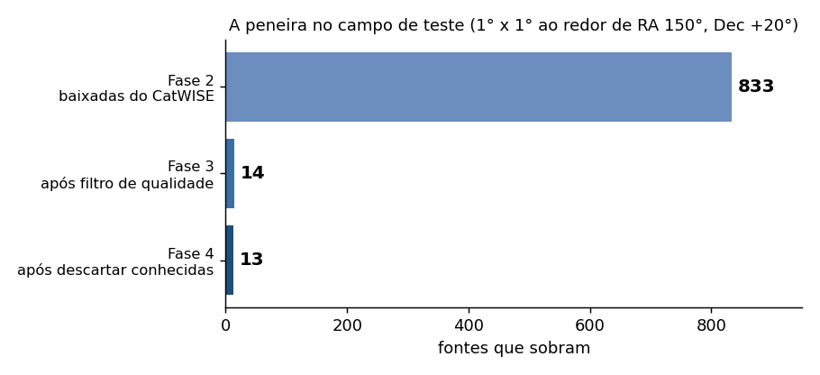

# Como funciona

## Contexto científico

O método não é novo. Kevin Luhman descobriu a **WISE 0855-0714** (a anã marrom mais fria conhecida, a ~2,3 parsecs, com movimento próprio de ~8"/ano) comparando imagens WISE de épocas diferentes. Voluntários de ciência cidadã, como os do projeto Backyard Worlds, também já acharam anãs ultrafrias vasculhando dados públicos: um deles, Frank Kiwy, achou sozinho dezenas de sistemas binários.

O que muda aqui é o catálogo. O CatWISE2020 (1,89 bilhão de fontes, combinando WISE e NEOWISE, 12 épocas em 8 anos) já traz o **movimento próprio calculado por fonte**, com precisão muito superior à de gerações anteriores. Não é preciso cruzar dois catálogos de épocas diferentes na mão: o ajuste já está feito, e melhor. Este projeto minera esse campo pronto.

## Que dado é esse

O CatWISE2020 é um **catálogo tabular**: cada linha é uma fonte detectada no infravermelho (um ponto no céu), não uma foto. As colunas são medições já reduzidas:

| Coluna | O que é |
|--------|---------|
| `ra`, `dec` | posição no céu (graus) |
| `w1mpro`, `w2mpro` | brilho nas bandas infravermelhas W1 (3,4 µm) e W2 (4,6 µm), em magnitudes |
| `w1snr`, `w2snr` | razão sinal-ruído da medida em cada banda |
| `pmra`, `pmdec` | **movimento próprio** já calculado pelo catálogo (arcsec/ano) |
| `pmcode`, `ka`, `km` | blend da fonte (`pmcode` = ABCCC, A = nº de componentes) e uso de astrometria/movimento |
| `w1flg`, `w2flg`, `cc_flags`, `ab_flags`, `n_aw` | flags de qualidade/contaminação (artefato, confusão de fontes) |

O pipeline **não processa imagens**. A Fase 2 é uma consulta `SELECT ... WHERE ...` em **ADQL** (uma linguagem tipo SQL), rodada no servidor do IRSA via **TAP**, um protocolo de consulta a catálogos astronômicos. Cada candidato que avança é uma linha dessa tabela. Imagens só entram no fim, na inspeção humana (Fase 6).

## Como o pipeline funciona

Fases sequenciais. Cada uma lê a tabela produzida pela anterior no SQLite e grava a sua, então elas se comunicam pelo banco, não por memória.

| Fase | O que faz | Status |
|------|-----------|--------|
| 1 | **Teste de sanidade**: redescobre Luhman 16 (PM ~2,7"/ano) e WISE 0855 (PM ~8"/ano) via CatWISE2020 + SIMBAD. Se Luhman 16 falhar, o pipeline aborta, porque não faz sentido caçar objetos novos com uma stack que não acha os conhecidos. WISE 0855 só gera aviso | ✅ |
| 2 | **Query ao CatWISE2020** (ADQL/TAP) numa região do céu, varrida em ladrilhos de 1 grau (um ladrilho que estoura o limite de linhas é dividido em 4), filtrando no servidor por movimento próprio, astrometria (ka=km=3) e qualidade de W2 (SNR e flag). Sem corte em W1: anãs Y são fracas nessa banda | ✅ |
| 3 | **Filtragem fina de qualidade**: remove contaminação/artefatos por `cc_flags`/`ab_flags`, troca do componente principal (`pmcode` B=N), confusão de fontes (`n_aw`) e movimento próprio pouco significativo (PM/σ < 8) | ✅ |
| 4 | **Cross-match contra SIMBAD** (via CDS XMatch em lote): descarta o que já é catalogado. O SIMBAD usa posições em J2000 e o CatWISE mede em ~2015, então a posição é recuada pelo movimento próprio antes do match. Sem isso, fontes com PM acima de ~0,3"/ano escapam como "novas". Depois, os que sobram são cruzados com 11 listas de anãs frias do VizieR (`CATALOGOS_ANAS` em `config.py`, como Karpov+2025, Kirkpatrick+2021/2024 e Best+2018) e com as 3.086 candidatas L/T do Backyard Worlds em Schneider+2026, que ainda não estão no VizieR (`catalogos/schneider2026.csv`), nas duas épocas, porque o SIMBAD demora a absorver catálogos novos | ✅ |
| 5 | **Triagem assistida por LLM**: prioriza os candidatos por consistência com uma anã L, T ou Y. A LLM ordena esforço humano, **nunca dá o veredito final**. O score varia entre rodadas (cerca de 1/3 dos candidatos mudam), então vale só como prioridade | ✅ |
| 6 | **Inspeção visual humana** (app Streamlit): recortes unWISE e óptico com mira na posição, animação do W2 por época, checklist com sugestão do pipeline, números, link pro WiseView, teste de movimento contra o AllWISE, busca por código e filtro por situação, decisão confirmar/dúvida/descartar gravada em `revisao_humana`. O notebook `inspecao_visual.ipynb` é a versão antiga, só com links | ✅ |
| 7 | **Relatório** dos confirmados (HTML com imagens embutidas), gerado por botão no app ou por `python src/relatorio.py` (que também grava um CSV), pra enviar a um astrônomo e pedir uma segunda opinião. Manual, como a Fase 6 | ✅ |

**Quanto os cortes deixam passar.** Os limiares foram medidos contra 949 anãs L/T/Y já conhecidas (`python tools/recall_conhecidas.py`, usa rede, ~8 min). Com os cortes atuais passam **76%** delas (L 80%, T 70%, Y 77%). Duas medições mudaram o desenho: filtrar o primeiro dígito do `pmcode` (A=1) derrubava o recall de 76% pra 25%, porque ele mede vizinhança e não qualidade; e cortar por SNR em W1 perdia metade das anãs Y. As conhecidas são as mais brilhantes, então o recall pra anãs ainda não descobertas tende a ser menor.



*Quantas fontes sobram em cada fase do pipeline.*

## Dados

Tudo em `data/rastro.db` (SQLite). Tabelas, em ordem de fase:

- `campo_bruto`: resultado da query TAP (Fase 2)
- `candidatos_fase3`: após filtro de qualidade
- `candidatos_fase4`: após cross-match SIMBAD e listas de anãs (com `status`, `simbad_match_id` e `catalogo_match`)
- `candidatos_fase5`: após triagem LLM (com `llm_triage_score` e `llm_triage_notes`)
- `revisao_humana`: suas decisões da Fase 6 (`confirmado`, `duvida` ou `descartado`, com nota). Tabela própria, que o pipeline não recria

## Estrutura

```
.
├── pipeline.py              # entrypoint (roda as fases 1-5)
├── config.py                # toda a parametrizacao
├── requirements.txt
├── README.md
├── src/
│   ├── sanity_check.py      # Fase 1
│   ├── fetch_field.py       # Fase 2
│   ├── quality_filter.py    # Fase 3
│   ├── known_catalog_match.py # Fase 4
│   ├── llm_triage.py        # Fase 5
│   ├── relatorio.py         # Fase 7: relatorio dos confirmados (HTML, e CSV pela linha de comando)
│   ├── campos.py            # proximo bloco 5x5 do ceu para o --proximo
│   ├── util.py              # prazo de relogio nas chamadas de rede
│   └── proper_motion.py     # util (pm_total, cor_w1w2)
├── tools/
│   ├── recall_conhecidas.py # mede o recall dos cortes contra anas conhecidas
│   ├── gerar_referencias.py # folhas de referencia da revisao (docs/img/ref_*.jpg)
│   └── gerar_funil.py       # grafico do funil (docs/img/funil_fases.png), lido do banco
├── app/
│   ├── revisao.py           # Fase 6: router do app Streamlit de revisao visual
│   ├── estilo.py            # tema escuro, cabecalho, ficha e checklist (CSS/HTML)
│   ├── dados.py             # leitura/gravacao das revisoes, URLs e checklist
│   ├── imagens.py           # recortes e animacao do W2, compartilhados pelas paginas
│   ├── guia.py              # como ler as imagens, exemplos bom x ruim e pista do treino
│   ├── cruzamento.py        # Gaia, Pan-STARRS e AllWISE, cruzados uma vez e guardados
│   ├── execucao.py          # botao Buscar mais candidatas (pipeline em segundo plano)
│   └── paginas/
│       ├── fila.py          # revisao visual: fila, imagens e decisao
│       └── treino.py        # modo treino: casos com resposta
├── .streamlit/
│   └── config.toml          # tema escuro e barra de ferramentas minima
├── tests/
│   └── test_units.py        # testes de unidade offline
├── docs/img/                # figuras usadas na documentacao
├── notebooks/
│   └── inspecao_visual.ipynb # versao antiga da Fase 6 (so links)
└── data/
    └── rastro.db            # resultados (gitignored)
```
