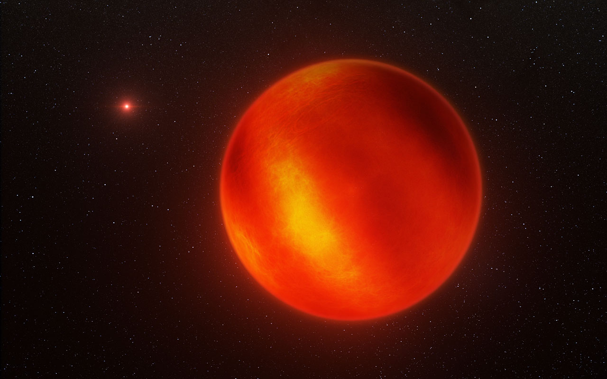
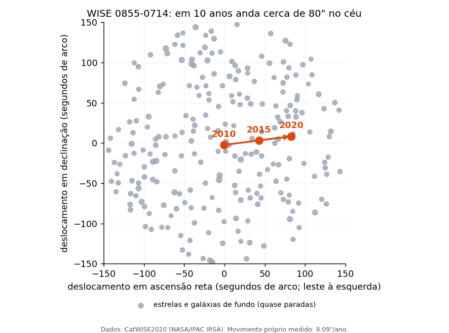
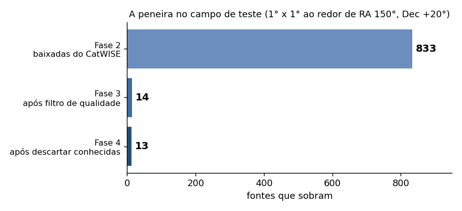

# Rastro

Pipeline de mineração de dados astronômicos que caça **anãs marrons e estrelas frias próximas ao Sol** ainda não catalogadas, procurando por **movimento próprio anômalo** no catálogo público **CatWISE2020**.



*Ilustração artística de uma anã marrom (Luhman 16B), parte do terceiro sistema mais próximo do Sol. Crédito: ESO/I. Crossfield/N. Risinger (skysurvey.org), [CC BY 4.0](https://creativecommons.org/licenses/by/4.0/).*

**[Experimente o treino online](https://rastro-treino.streamlit.app/?embed=true)**: casos de resposta conhecida, direto no navegador, sem instalar nada. As suas respostas ficam só na sua sessão.

## Em palavras simples

**A pergunta:** existem objetos frios e escuros perto do Sol que ninguém descobriu ainda?

**O que se procura:** as *anãs marrons*, "estrelas fracassadas". Têm massa demais pra serem planetas e de menos pra acender como uma estrela. Quase não emitem luz visível, mas emitem calor (infravermelho), então um telescópio infravermelho consegue enxergá-las.

**Como achar:** as estrelas parecem paradas no céu, mas as que estão perto se mexem devagar, ano após ano. É como olhar a paisagem pela janela do carro: o poste ao lado passa rápido, a montanha ao longe parece parada. Esse deslocamento no céu se chama *movimento próprio*. Um objeto que se move muito pra um ponto tão apagado é um forte suspeito de estar perto de nós.



*Quase tudo no fundo (cinza) fica no lugar. A WISE 0855-0714 (laranja), a anã marrom mais fria que se conhece, anda cerca de 80 segundos de arco em 10 anos. É esse tipo de movimento que o projeto procura.*

**Onde estão os dados:** o telescópio espacial WISE fotografou o céu todo várias vezes ao longo de 8 anos. Astrônomos já transformaram essas fotos numa enorme tabela pública, o *CatWISE2020*, com 1,89 bilhão de linhas. Cada linha é um ponto de luz, com sua posição, seu brilho e o quanto ele se mexeu. **O projeto não olha fotos nem usa telescópio: ele lê essa tabela e filtra.**

**O que o programa faz, passo a passo.** Pense numa peneira com várias malhas, cada uma deixando passar menos gente:

1. **Confere as ferramentas.** Procura dois objetos famosos que já se conhece. Se não os achar, algo está errado e o programa para.
2. **Baixa um pedaço do céu.** Hoje, 25 graus quadrados (quadrados de 1 grau por 1 grau, cada um com cerca de 5 vezes a área da Lua cheia), só com pontos que se movem rápido.
3. **Joga fora medidas duvidosas.** Defeitos do instrumento, pontos colados em vizinhos e movimentos pequenos demais pra distinguir de erro de medida.
4. **Joga fora o que já é conhecido.** Compara com o SIMBAD, o grande cadastro de objetos astronômicos, e com listas publicadas de anãs frias que o SIMBAD ainda não absorveu.
5. **Pede a nota de uma IA.** Uma IA lê os números de cada sobrevivente e dá uma nota de prioridade. Ela só ajuda a ordenar, nunca decide.
6. **Olhar humano.** As imagens de cada suspeito são conferidas à mão, num app local (`python iniciar.py`) que mostra os recortes, os números e a nota da IA, e guarda a sua decisão.
7. **Relatório pra um astrônomo.** Os candidatos que você confirmou saem numa página só, com imagens e números, prontos pra pedir uma segunda opinião. A opinião em si ainda está por fazer.



*Quantas fontes sobram em cada fase do pipeline.*

## O que entra, o que sai

**O que alimenta o programa**
- **Uma região do céu**, dada por coordenadas (RA e Dec) em `config.py`, e os limiares dos filtros (quão rápido o ponto tem de se mover, quão nítida a medida precisa ser).
- **Dois bancos de dados públicos**, baixados da internet na hora: a tabela CatWISE2020 (NASA/IPAC) e o cadastro SIMBAD (CDS, Estrasburgo).
- **Uma chave grátis de IA** (Groq), só pra nota da última fase. Ela é opcional: sem chave, a busca pula a triagem.

**O que ele devolve**

Uma tabela, `candidatos_fase5`, no arquivo `data/rastro.db`. Cada linha é um **suspeito**: código da fonte, posição no céu, brilho e cor no infravermelho, movimento próprio (e quantas vezes ele é maior que o erro de medida), a nota da IA (`alta`, `media`, `baixa` ou `incerta`) e um parágrafo curto com o motivo da nota. Pra ver a lista, ordenada pelos que mais se movem:

```bash
python -c "import sqlite3, pandas as pd; print(pd.read_sql('SELECT source_id, ra, dec, pm_total, llm_triage_score FROM candidatos_fase5 ORDER BY pm_total DESC', sqlite3.connect('data/rastro.db')))"
```

**O que fazer com o resultado**

A lista é de *suspeitos*, não de descobertas. O caminho depois dela:

1. **Olhar as imagens** dos suspeitos, começando pelos que o AllWISE mostra se movendo (a nota da IA é só um comentário). O app `app/revisao.py` mostra os recortes de cada suspeito e grava sua decisão. Veja [Revisão e treino](revisao.md).
2. **Descartar os falsos alarmes.** Na prática, quase todos caem aqui: ruído, defeito do instrumento ou ponto mal medido.
3. **Levar os que sobrarem a um astrônomo**, que pode confirmar com outras observações (um espectro, por exemplo) e, se for novo de verdade, publicar.

## O que conta como sucesso (honesto)

| Nível | O que é | Prometido? |
|------|---------|-----------|
| **Mínimo** | Pipeline rodando ponta a ponta e **redescobrindo um objeto conhecido** (o teste de sanidade) | Sim, é o critério de aceite |
| **Bom** | Lista curta e defensável de candidatos não catalogados numa região real, sem artefatos óbvios | Sim, com esforço razoável |
| **Moonshot** | Um candidato genuinamente novo, validado por segunda opinião | Não, é o horizonte |

O valor entregue está no pipeline funcionar corretamente, não no achado em si.

## Por onde seguir

- [Instalar sem terminal](instalar.md): o passo a passo para Windows e macOS.
- [Começar](comecar.md): rodar o pipeline pelo terminal e configurar a chave da LLM.
- [Como funciona](como-funciona.md): o contexto científico, o dado e as fases do pipeline.
- [Revisão e treino](revisao.md): o app local de revisão visual e o modo treino.
- [Relatório e segunda opinião](relatorio.md): gerar o relatório dos confirmados.
- [Resultados](resultados.md): o que a varredura do autor encontrou até agora.
- [Créditos](creditos.md): dados, referências e licença.
