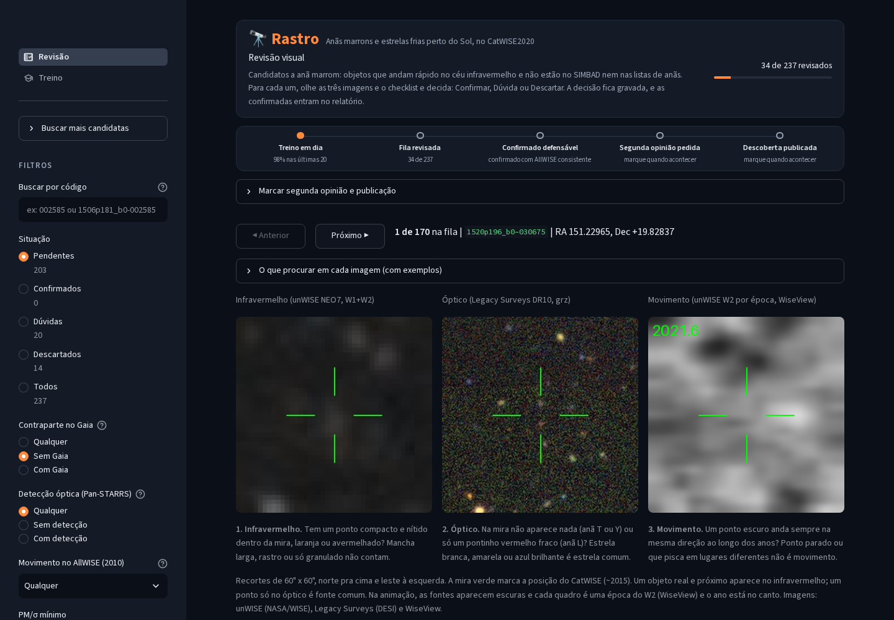
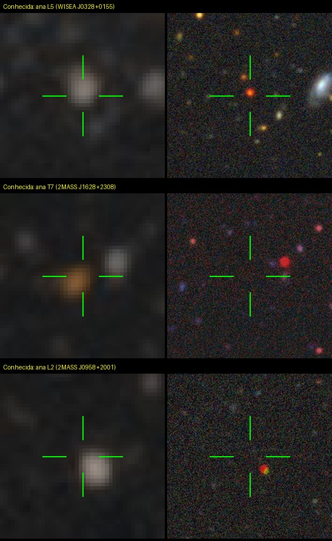
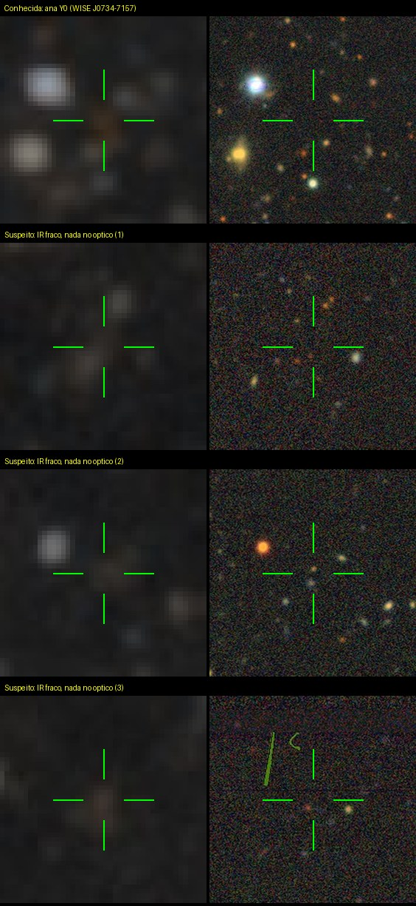
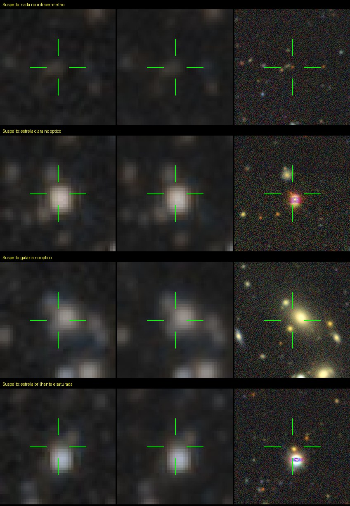
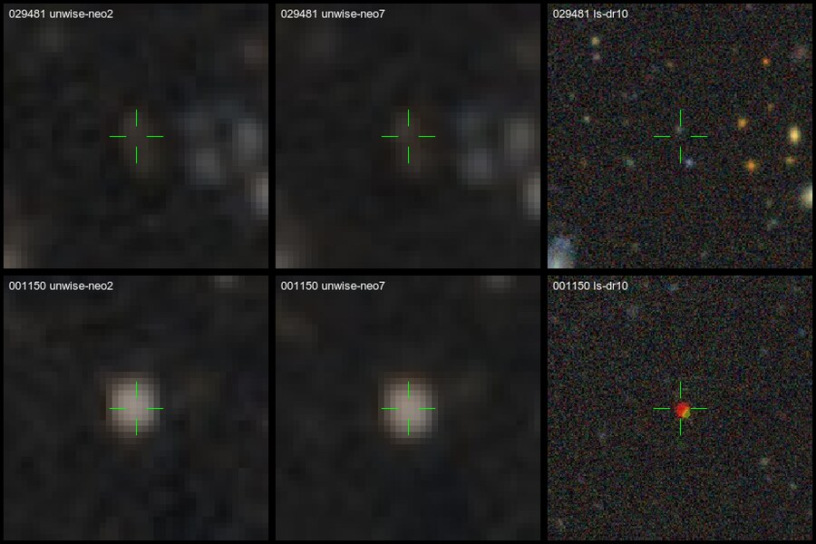

# Revisão e treino

A Fase 6 é a inspeção visual humana, feita num app Streamlit local. Para cada suspeito, o app mostra os recortes, os números, a nota da IA e a sua decisão gravada no banco.

*A tela de revisão: para cada candidato, o recorte infravermelho, o óptico e a animação do movimento por época, com a pergunta de cada imagem e o progresso do trabalho no topo.*

**[Experimente o treino online](https://rastro-treino.streamlit.app/?embed=true)**: casos de resposta conhecida, direto no navegador, sem instalar nada. As suas respostas ficam só na sua sessão.

## O que fazer com o resultado

A lista é de *suspeitos*, não de descobertas. O caminho depois dela:

1. **Olhar as imagens** dos suspeitos, começando pelos que o AllWISE mostra se movendo (a nota da IA é só um comentário). O app `app/revisao.py` mostra os recortes de cada suspeito e grava sua decisão. Os recortes mostram se há um objeto real ali; o movimento aparece na animação "Movimento" (quadros do W2 por época, do WiseView) e no teste do AllWISE.
2. **Descartar os falsos alarmes.** Na prática, quase todos caem aqui: ruído, defeito do instrumento ou ponto mal medido.
3. **Levar os que sobrarem a um astrônomo**, que pode confirmar com outras observações (um espectro, por exemplo) e, se for novo de verdade, publicar.

## O app

Para abrir, rode `python iniciar.py` (veja [Começar](comecar.md#como-usar)). O app abre no navegador com a fila de candidatos pendentes e sem contraparte no Gaia, com os que o AllWISE mostra se movendo primeiro e depois do mais ao menos significativo. Na primeira abertura ele cruza a lista com Gaia, Pan-STARRS e AllWISE (alguns segundos). As páginas ficam em `app/paginas/` (`fila.py` para a revisão e `treino.py` para o treino), e o tema escuro e os componentes visuais vêm de `.streamlit/config.toml` e `app/estilo.py`. O guia "O que procurar em cada imagem" explica como ler as três imagens e o que decide. Quando a fila acabar, o botão "Buscar mais candidatas" (com confirmação, progresso e cancelamento) escolhe sozinho o próximo bloco do céu e roda o pipeline; o mesmo pelo terminal é `python -u pipeline.py --proximo`.

## Na barra lateral

- **Situação:** pendentes, confirmados, dúvidas, descartados ou todos, cada um com a contagem. É por aqui que se revê o que já foi classificado.
- **Buscar por código:** acha qualquer candidato pelo código (ou pelo final dele), em qualquer situação.
- **Filtros** de Gaia, Pan-STARRS, movimento no AllWISE, PM/σ mínimo e nota da IA, e a **ordenação**.
- **Já foi publicado?** Um botão consulta o VizieR inteiro em volta do candidato e destaca os catálogos de anãs ou de movimento próprio, com a distância. A Fase 4 só cruza as listas conhecidas, e é assim que se acha um catálogo novo que ainda não entrou nelas. Use antes de confirmar. O relatório da Fase 7 faz a mesma busca para cada candidato.
- **Relatório (Fase 7):** no corpo da página, o botão "Gerar relatório" monta uma página HTML com os confirmados (ou confirmados e dúvidas, se marcar a caixa) e o botão "Baixar relatório" entrega o arquivo. Leva alguns segundos por candidato, para baixar os recortes.
- No corpo da página, o quadro "Fila completa" lista a fila, e um clique numa linha abre aquele candidato.

## O teste do AllWISE

O AllWISE mediu o céu uns 5 anos antes do CatWISE. Se o movimento próprio de um candidato for real, a fonte tem de aparecer lá na posição recuada pelo movimento, e não onde ela está hoje. O app marca cada candidato como *se moveu (confere)*, *não se moveu*, *ambíguo*, *sem fonte* ou *PM baixo demais pra testar*. O AllWISE é mais raso que o CatWISE, então um candidato fraco quase sempre cai em "sem fonte", e isso não prova nada.

As decisões ficam na tabela `revisao_humana` do mesmo banco e não são apagadas quando o pipeline roda de novo.

## Como decidir na revisão visual

| O que você vê | Decisão |
|---|---|
| Nada no centro das imagens de infravermelho, só ruído | **Descartar** |
| Mancha larga e difusa (galáxia), ou colada numa estrela brilhante, ou no meio dos "raios" de uma estrela | **Descartar** |
| No óptico, uma estrela clara (branca, amarela ou azul) no centro | **Descartar** (estrela comum) |
| Ponto nítido no infravermelho, laranja ou avermelhado, e **nada** no óptico | **Confirmar** (compatível com anã T ou Y) |
| Ponto nítido no infravermelho e um ponto **vermelho fraco** no óptico | **Confirmar** (compatível com anã L), mas com cor W1-W2 abaixo de ~0,3 pode ser só uma anã M comum, então prefira **Dúvida** |
| Ponto no infravermelho, mas fraco, colado numa vizinha, ou você não conseguiu conferir o movimento | **Dúvida** |

## Detalhes que ajudam

- O objeto se move. No óptico, ele pode estar um pouco deslocado da mira, na direção do movimento (movimento próprio x anos de diferença entre as imagens). Dentro do espaço vazio da mira (cerca de 6") ainda conta como no lugar.
- No unWISE, cor avermelhada ou alaranjada é o que se espera de uma anã fria. Azul ou branco é estrela comum.
- O app compara cada candidato com o AllWISE (~2010): "se moveu (confere)" reforça o caso, "não se moveu" pesa contra, e "sem fonte" não diz nada (o candidato é fraco demais pra aparecer lá).
- **Confirmar** não é descoberta: quer dizer "passa no olho". O teste decisivo é a animação "Movimento" ao lado dos recortes: o ponto tem de andar sempre na mesma direção, ano após ano. O link do WiseView abre a mesma animação em tamanho maior.
- **Descartar** não apaga nada: a decisão fica gravada com a nota e dá pra rever no filtro "Situação".

## Checklist, animação e modo treino

- **Checklist.** Abaixo dos números, o app marca com ✅, ⚠️ ou ❌ cinco testes (movimento, AllWISE, Gaia, cor W1-W2 e óptico) e fecha com "Sugestão do pipeline". A sugestão é só um resumo dos números: ela só vale se os dois testes humanos passarem, um ponto nítido no infravermelho dentro da mira e, na animação, o ponto andando sempre na mesma direção.
- **Animação.** A terceira imagem mostra o movimento: quadros do W2 do unWISE por época, montados pelo servidor do WiseView, com a mira no lugar e o ano escrito em cada quadro. Se o servidor falhar, a página mostra um aviso e continua funcionando.
- **Modo treino.** A página `treino`, na barra lateral do app, sorteia casos já resolvidos, o mesmo número para cada resposta: anãs L/T/Y conhecidas que passariam pelos mesmos filtros da fila (uma anã fraca demais para ver nas imagens não entra), estrelas comuns de alto movimento do SIMBAD e candidatos rejeitados pela Fase 3 por artefato ou por movimento bem abaixo do erro. Cada grupo é escolhido parecido com a fila em brilho (W2) e em movimento sobre o erro (PM/σ): as anãs conhecidas são em geral 2 a 3 magnitudes mais brilhantes que os candidatos, e sem esse pareamento o treino fica bem mais fácil que a revisão. Mesmo pareado, ele ainda é um pouco mais fácil, porque quase não há anã conhecida tão fraca quanto o meio da fila (W2 ≈ 16,3). Na fila, é normal passar dezenas sem nenhum candidato óbvio. Os casos são cruzados com Gaia, Pan-STARRS e AllWISE uma vez, como a fila, então o checklist e a sugestão funcionam igual à revisão. O caso vem sem a resposta; depois do clique, o app mostra a resposta, a explicação e se você acertou. Dúvida vale meio ponto. Cada resposta fica gravada na tabela `treino_historico`, e o quadro "Seu histórico" mostra o acerto geral, o das últimas 20 respostas e o acerto separado por resposta certa: diferença grande entre eles indica viés, como confirmar quase tudo. No topo do treino aparece o nível (Aprendiz, Revisor ou Revisor confiável, pelas últimas 20 respostas), e a revisão mostra a trilha do trabalho: treino em dia, fila revisada, um confirmado com AllWISE consistente, segunda opinião pedida e descoberta publicada (as duas últimas você marca). Nada dá ponto por confirmar candidato. As anãs do treino saem de `data/recall_conhecidas.pkl`, gravado por `python tools/recall_conhecidas.py` (usa rede, ~8 min). Sem esse arquivo, o treino usa os casos prontos da demo online, que vêm com o projeto.

## Casos de referência

*Confirmar*

Em cada linha: infravermelho (unWISE NEO7) e óptico (Legacy Surveys). As três primeiras linhas desta folha são exemplos de **confirmar**.

1. **Anã L5 conhecida.** Bolha nítida no infravermelho e um ponto vermelho no óptico, os dois na mira.
2. **Anã T7 conhecida.** Bolha alaranjada no infravermelho, na borda da mira (o objeto andou desde 2015) e nada no óptico naquela posição. O ponto vermelho à direita, no óptico, é outra fonte.
3. **Anã L2 conhecida, do próprio campo varrido.** Bolha nítida no infravermelho e um pontinho vermelho no óptico, os dois logo abaixo da mira: a posição do catálogo é de 2000 e o objeto andou desde então. Um suspeito com essa cara vale levar ao WiseView.

*Dúvida*

1. **Anã Y0 conhecida.** Um borrão marrom fraquíssimo no infravermelho, nada no óptico, vizinhas brilhantes por perto. **Uma anã Y real parece isso.**
2. **Três suspeitos do campo** com a mesma cara: fraco no infravermelho, nada no óptico. Sem ver o movimento no WiseView não dá pra distingui-los de ruído, e é por isso que o certo é **dúvida** (e não descartar).

*Descartar*

1. **Nada no infravermelho.** Só um rastro difuso e sem forma, sem a bolha compacta de um objeto real.
2. **Estrela clara no óptico.** Ponto brilhante, com núcleo estourado, bem na mira.
3. **Galáxia.** No óptico aparece uma galáxia grande e amarela, com estrutura.
4. **Estrela brilhante e saturada.** O "estouro" azul-lilás é típico de estrela forte demais pra câmera.

*Cada linha tem 2 recortes de 60" x 60": infravermelho (unWISE NEO7) e óptico (Legacy Surveys). Embaixo, a anã L2 já catalogada 2MASS J09585080+2001525: nítida no infravermelho e vermelha no óptico. Em cima, um suspeito que a IA chegou a marcar como `alta`: quase nada aparece no centro, sinal de falso alarme. Imagens: unWISE (NASA/WISE) e Legacy Surveys (DESI), via visualizador do Legacy Surveys.*

## Perguntas frequentes

**As minhas decisões ficam salvas?** Sim. Cada clique grava na tabela `revisao_humana` do arquivo `data/rastro.db` na hora. Fechar o navegador ou o app não perde nada, e o pipeline nunca apaga essa tabela.

**Quando entram candidatos novos?** Só quando você roda uma busca nova: o botão "Buscar mais candidatas" (ou `python pipeline.py --proximo`) varre a próxima região do céu e acrescenta os candidatos dela à fila. Os já revisados continuam com a decisão.

**O que quer dizer o filtro "Com Gaia"?** O Gaia mede no óptico. Uma anã marrom é fria e quase não emite luz visível, então raramente aparece nele; um ponto com contraparte no Gaia costuma ser estrela comum já conhecida. Por isso o filtro começa em "Sem Gaia".

**E o filtro do Pan-STARRS?** Também é óptico, mas mais fundo que o Gaia. Anãs T e Y somem nele, enquanto anãs L aparecem. Serve para ordenar a fila, não para descartar.

**Preciso deixar a aba em primeiro plano enquanto o app prepara os casos?** Não. O trabalho roda no app local, não na aba; mudar de aba ou minimizar a janela não interrompe. Só não feche a janela do iniciador (ou o terminal), que é o app.
